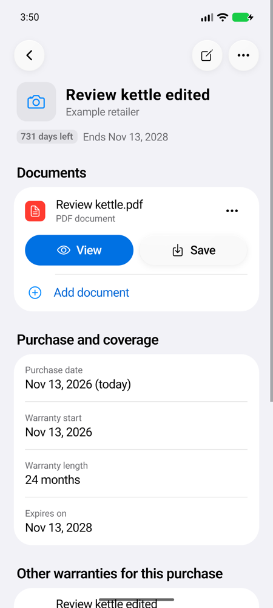

# Warrantly

**Every warranty in one place, with the days left counted for you.**

Warrantly is an Android app that finds purchase and warranty emails in your Gmail, keeps the receipts and PDFs
with each purchase, and reminds you before a warranty ends. Everything stays on your phone: no account, no server,
no ads, no tracking.

<p align="center">
  
  
  
  
</p>

## Features

- **Finds warranties for you.** Reads Gmail (read-only, several accounts) and picks out purchase mails and warranty documents.
- **Days left, at a glance.** A library grouped by status with a plain days-left badge; filter by store, search, ignore what does not matter.
- **Documents first.** Attached PDFs, photos and scans open inside the app; scan paper receipts with on-device text recognition.
- **Reminders.** Before a warranty ends, and for the return window of online orders. You choose when.
- **Repair and claim history**, price and category, several warranties per purchase (standard, extended).
- **Private by design.** Optional PIN and biometric lock, encrypted backup to your own Google Drive, export to PDF, CSV or JSON, delete everything in one tap.
- **English and Hungarian**, light and dark, large-text friendly, home-screen widget and app shortcuts.

## Design

The interface follows the bencepc.hu iOS 27 design system, rebuilt natively in React Native. The measured values,
what the reference does not define and the platform limits are in [docs/visual-reference.md](docs/visual-reference.md).

## Tech

Expo SDK 58, React Native 0.88, Expo Router, TypeScript, on-device SQLite. Local Expo modules in Kotlin handle
Gmail account tokens (`modules/google-account-token`) and PDF rendering (`modules/pdf-pages`). The email parser,
mail layer, backup format (scrypt + AES-256-GCM) and database logic are plain TypeScript with Node tests.

## Run it

The app uses native modules, so Expo Go cannot run it. Build a test APK in the cloud and install it:

```sh
npm install
npx eas-cli@latest build --platform android --profile preview
```

JavaScript-only changes reach an installed build over the air with `npx eas-cli@latest update --channel preview`.
A change that adds native code needs a new `version` in `app.json` and a new build.

## Checks

```sh
npm test            # parser, Gmail adapter, database, backup, translation key parity
npm run typecheck
npx expo lint
```

GitHub Actions builds the app and drives it on an Android emulator with Maestro (`.maestro/`, workflow
`.github/workflows/device-test.yml`).

## Docs

- [Privacy policy](docs/privacy.md)
- [Visual reference and design checklist](docs/visual-reference.md)
- [UI polish notes](docs/ui-polish.md)
- [Development notes and release history](docs/development.md)
- [Original plan](docs/brainstorm.md)
