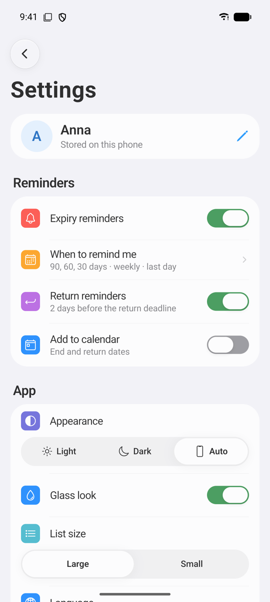

<div align="center">


# Warrantly

**Every warranty in one place. Private by design.**

An Android app that finds your purchase and warranty emails, keeps the receipts with each purchase and counts the days left.


[Screenshots](#screenshots) · [Features](#features) · [Privacy](#privacy) · [Install](#install) · [Design](#design) · [Under the hood](#under-the-hood) · [Docs](#docs)

</div>

---

Warrantly keeps your warranties on your phone: the product, the store, the dates, the receipt. Add a purchase by hand, scan its receipt or share a PDF or an email into the app. Open the app and see what is still covered, what ends soon and what has expired. No Warrantly account, no Warrantly server, no ads, no tracking.

---

## Screenshots

<table>
  <tr>
    <td width="25%" valign="top"><br /><b>Library</b><br />Grouped by status, with a plain days-left badge.</td>
    <td width="25%" valign="top"><br /><b>Documents first</b><br />The receipt and PDFs open in one tap.</td>
    <td width="25%" valign="top"><br /><b>Filter</b><br />By store, status or search.</td>
    <td width="25%" valign="top"><br /><b>Add or edit</b><br />Large fields, one Save button.</td>
  </tr>
  <tr>
    <td width="25%" valign="top"><br /><b>Settings</b><br />Reminders, backup, lock, language.</td>
    <td width="25%" valign="top"><br /><b>Clear confirmations</b><br />Destructive actions say what they do.</td>
    <td colspan="2"></td>
  </tr>
</table>

<sub>Screens show synthetic demo data.</sub>

---

## Features

| | What Warrantly provides |
| --- | --- |
| ➕ **Quick to add** | Type it in, scan a paper receipt or a serial number, or share a PDF, a photo or an email (its text, or an .eml file) into Warrantly. |
| 📧 **Gmail import (coming)** | Reads Gmail read-only and picks out warranty mails. Built, but hidden in 1.0 until Google finishes its review of the Gmail permission. |
| ⏳ **Days left at a glance** | Covered, ending soon and expired, with a plain badge. Filter by store, search, ignore what does not matter. |
| 📄 **Documents first** | Mail PDFs, photos and scans open inside the app. Scan a paper receipt with on-device text recognition. |
| 🔔 **Reminders** | Before a warranty ends and for the return window of online orders. You choose when. |
| 🛠 **History and claims** | Repairs, notes, price and category, several warranties per purchase (standard, extended), a shortcut to the store's support. |
| 🔒 **Private by design** | Optional PIN and biometric lock, encrypted backup to your own Google Drive, export to PDF, CSV or JSON, delete everything in one tap. |
| 🌍 **Made for everyone** | English and Hungarian, light and dark, large-text friendly, a home-screen widget and app shortcuts. |

---

## Privacy

Warrantly has no server and no account of its own. Your warranties live in a database on the phone. Data leaves the phone only when you choose: an encrypted backup to your own Google Drive (scrypt and AES-256-GCM, encrypted on the phone first), or an export or share you start. Version 1.0 does not ask for Gmail access; Gmail import waits for Google's review of the `gmail.readonly` permission ([status](docs/gmail-verification.md)).

Read the full [privacy policy](https://bencepc.hu/warrantly/privacy/) and [terms](https://bencepc.hu/warrantly/terms/). Website: [bencepc.hu/warrantly](https://bencepc.hu/warrantly/).

---

## Install

Warrantly is not on Google Play yet. Install the APK from GitHub:

1. Open the [latest release](https://github.com/ScideCodes/Warrantly/releases/latest) on your Android phone.
2. Under **Assets**, tap the `.apk` file to download it.
3. Open the download. If Android asks, allow your browser to install unknown apps.

Releases without an APK are over-the-air updates: an installed app downloads them by itself on its next launch.

### Build it yourself

For developers. Needs Node 22.18 or newer and the Android SDK. The app uses native modules, so Expo Go cannot run it.

```sh
npm ci
npx expo run:android      # debug build on a connected phone or emulator
```

Google sign-in (Drive backup) works only in builds signed with a key registered in this project's Google Cloud OAuth client. A build signed with your own key runs, but Drive backup fails until you create your own OAuth client and put its web client ID in `src/google.ts`. Cloud builds and over-the-air updates use the maintainer's EAS project; see [docs/releasing.md](docs/releasing.md).

---

## Design

The interface follows the bencepc.hu iOS 27 design system, rebuilt natively in React Native: grouped cards, large titles, a floating tab bar that minimizes while you scroll, floating sheets and glass buttons. Measured values, what the reference does not define and the platform limits are written down in [docs/visual-reference.md](docs/visual-reference.md).

---

## Under the hood

| | |
| --- | --- |
| **App** | Expo SDK 58, React Native 0.88, Expo Router, TypeScript, on-device SQLite |
| **Native** | Two small local Expo modules in Kotlin: Gmail account tokens (`modules/google-account-token`) and PDF page rendering (`modules/pdf-pages`) |
| **Logic** | Email parser, Gmail adapter, backup format and database logic are plain TypeScript, tested in Node |
| **Checks** | 149 unit tests, strict typecheck, lint; Maestro flows drive the app on an Android emulator in GitHub Actions |

```sh
npm test            # parser, Gmail adapter, database, backup, translation key parity
npm run typecheck
npx expo lint
```

---

## Docs

[Privacy policy](https://bencepc.hu/warrantly/privacy/) ([source](docs/privacy.md)) · [Gmail verification](docs/gmail-verification.md) · [Releasing](docs/releasing.md) · [Visual reference](docs/visual-reference.md) · [UI polish notes](docs/ui-polish.md) · [Development notes](docs/development.md) · [Original plan](docs/brainstorm.md)

## License

[MIT](LICENSE). Security reports: see [SECURITY.md](SECURITY.md).
