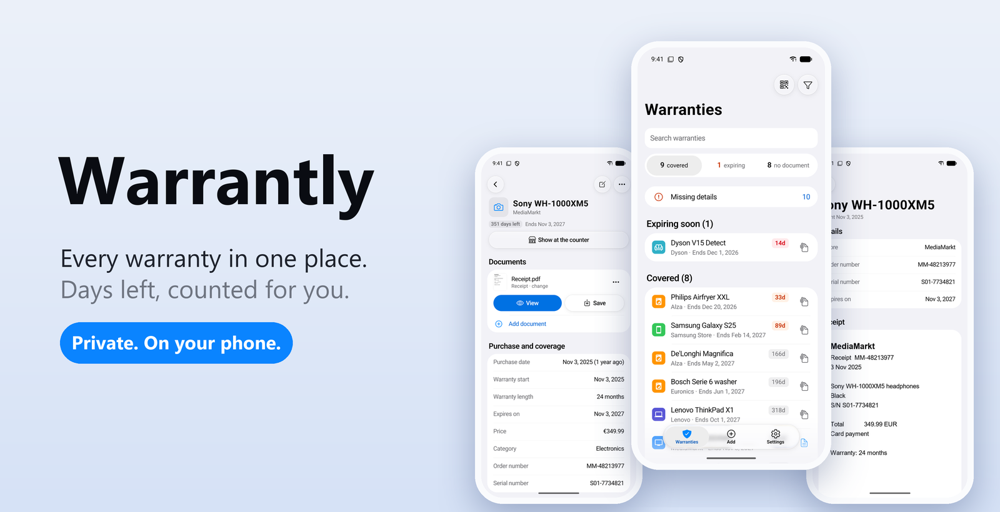
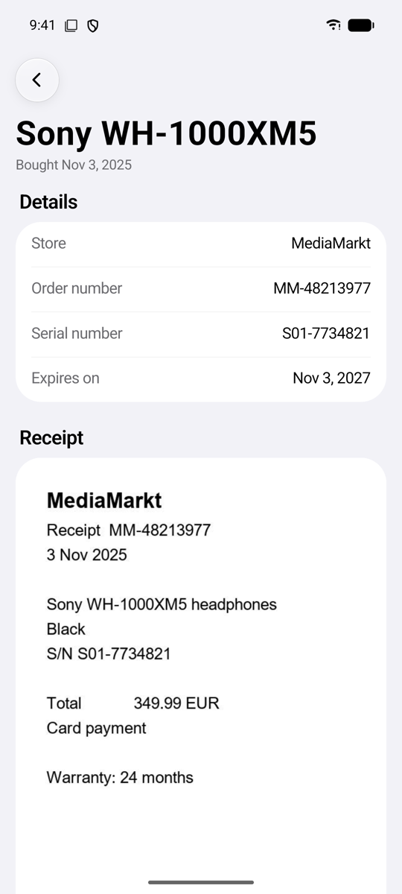
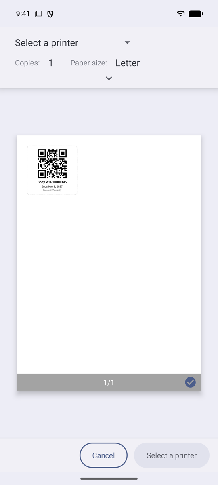
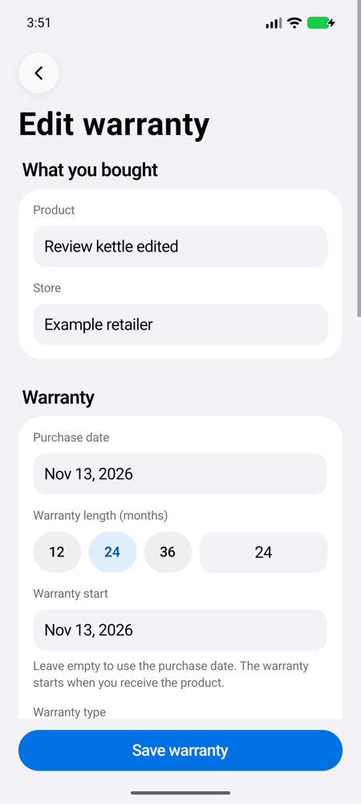
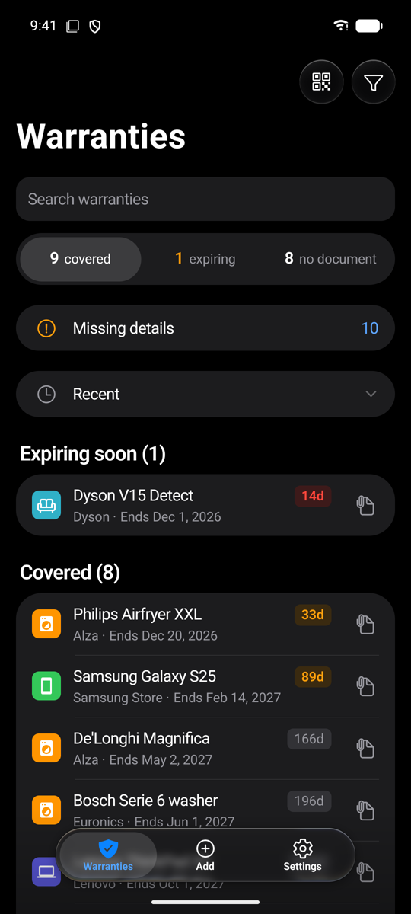
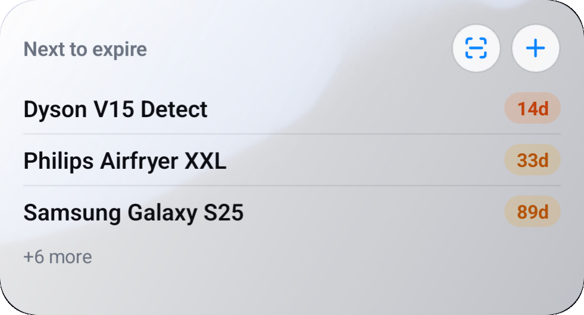

<div align="center">

<a href="https://github.com/ScideCodes/Warrantly/releases/latest">
  
</a>

# Warrantly

**Every warranty in one place. Private, on your phone.**


### [⬇ Download for Android](https://github.com/ScideCodes/Warrantly/releases/latest)

</div>

---

Keep your receipts and warranties together. Warrantly counts the days left and reminds you before a warranty ends. No account, no ads, no tracking.

## Screenshots

<table>
  <tr>
    <td width="25%" valign="top">
      
      <br /><b>Your list</b><br />What is covered, what ends soon, and how many days are left.
    </td>
    <td width="25%" valign="top">
      
      <br /><b>Receipt first</b><br />The receipt is one tap away, with every detail below it.
    </td>
    <td width="25%" valign="top">
      
      <br /><b>At the counter</b><br />Shows the receipt big and bright for the shop assistant.
    </td>
    <td width="25%" valign="top">
      
      <br /><b>QR sticker</b><br />Stick it on the item. Scan it later to open the warranty.
    </td>
  </tr>
  <tr>
    <td width="25%" valign="top">
      
      <br /><b>Quick to add</b><br />Scan a receipt or type a few fields. The end date is worked out for you.
    </td>
    <td width="25%" valign="top">
      
      <br /><b>Sort and filter</b><br />By end date, price, store or category.
    </td>
    <td width="25%" valign="top">
      
      <br /><b>Reminders</b><br />Pick when to be reminded, or add the dates to your calendar.
    </td>
    <td width="25%" valign="top">
      
      <br /><b>Dark mode</b><br />Follows your phone, or pick light or dark.
    </td>
  </tr>
</table>

<p align="center"><br /><b>Home screen widget</b><br />What ends next, or the warranties you pick. Scan and add are one tap away.</p>

## What it does

- **Days left at a glance:** covered, ending soon, or ended.
- **Receipts kept safe:** photos and PDFs open in the app, with zoom.
- **Scan receipts:** the text is read on your phone, nothing is uploaded.
- **Reminders:** before a warranty ends, and before the return window closes.
- **Counter mode:** the receipt full screen, at full brightness.
- **QR stickers:** print one, stick it on the item, scan to open.
- **Calendar:** end dates and return deadlines in your phone's calendar.
- **Claims:** repair notes, store contacts and a ready-to-send claim pack.
- **Home screen widget:** what ends next, or only the warranties you pick, in glass that fits any size.
- **Backup:** encrypted on your phone, then saved to your own Google Drive.
- **Lock:** PIN or fingerprint. While it is on, receipts stay out of screenshots and reminders hide product names.
- **English and Hungarian.**

## Install

1. Open the [latest release](https://github.com/ScideCodes/Warrantly/releases/latest) on your phone.
2. Download the `.apk` file under **Assets** and open it.
3. If Android asks, allow your browser to install apps.

Small updates arrive inside the app. Bigger ones come as a new APK. Install it over the old one, and your data stays.

## Privacy

- Everything stays on your phone, in the app's own storage.
- Backups are encrypted (AES-256-GCM) before they leave the phone. Only you have the password.
- The app works offline, including receipt scanning.

Read the [privacy policy](docs/privacy.md).

## For developers

React Native 0.88, Expo SDK 58, Expo Router, TypeScript and on-device SQLite. PDF pages are drawn by a small Kotlin module in `modules/pdf-pages`.

Needs **Node.js 22.18+**.

```sh
npm ci
npm start
npm run typecheck
npm run lint
npm test
```

Native modules need a development build (`npx eas-cli@latest build --platform android --profile preview`). See [development](docs/development.md) and [releasing](docs/releasing.md).

## License

[MIT](LICENSE). Made by Bence · [scide.business@gmail.com](mailto:scide.business@gmail.com) · [Website](https://bencepc.hu/warrantly/)
