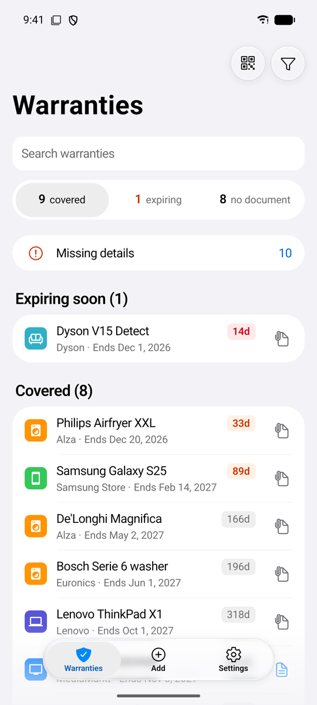
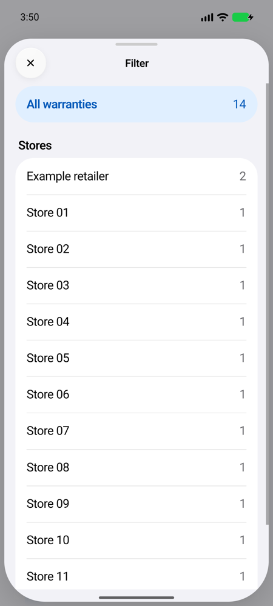
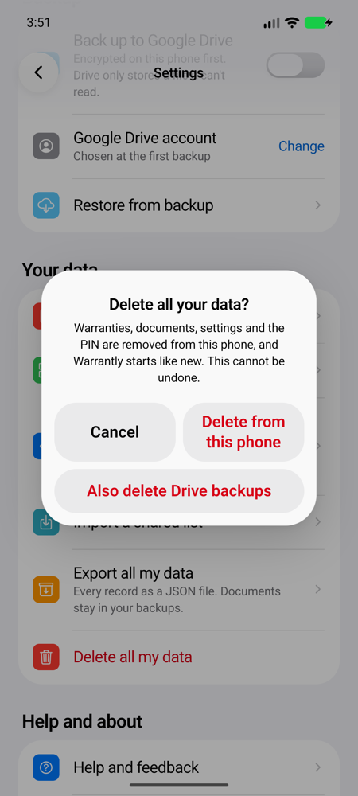
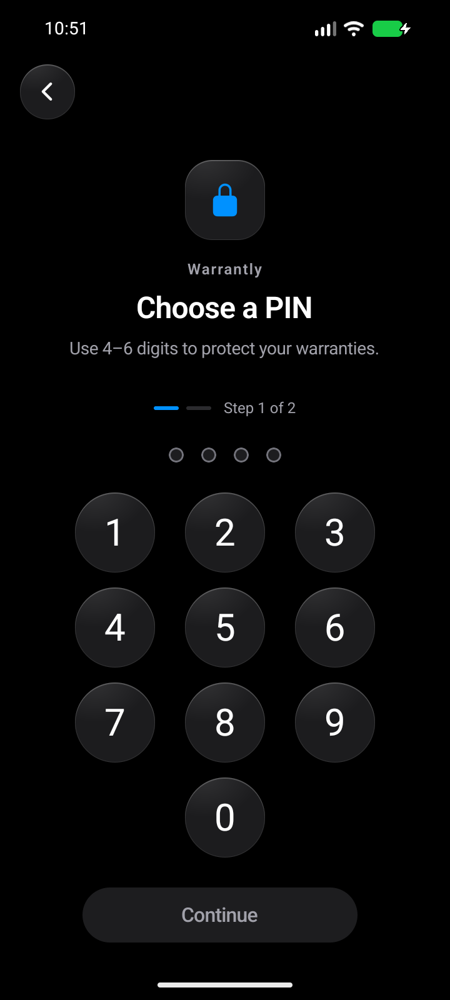

<div align="center">

<a href="https://github.com/ScideCodes/Warrantly/releases/latest">
  
</a>

# Warrantly

**Every warranty in one place. Private by design.**

An intuitive Android app that organizes your warranties, keeps receipts with each purchase, tracks remaining days, and sends timely expiry reminders.


### [⬇ Download Warrantly for Android](https://github.com/ScideCodes/Warrantly/releases/latest)

[Screenshots](#screenshots) · [Features](#features) · [How to use](#how-to-use) · [Install](#install) · [Privacy](#privacy-by-design) · [Under the hood](#under-the-hood) · [Development](#run-the-source)

</div>

---

Warrantly keeps your product warranties, purchase receipts, and expiry dates organized locally on your phone. See at a glance what is still covered, what ends soon, and what has expired. Scan paper receipts with on-device text recognition, bundle items bought together, and back up securely with client-side encrypted Google Drive sync. 

No account, no external server, no ads, and no tracking.

---

## Screenshots

<table>
  <tr>
    <td width="25%" valign="top">
      <a href="docs/screenshots/library.png">
        
      </a>
      <br /><b>Warranty Library</b><br />Grouped by status (Covered, Expiring Soon, Expired) with live days-left badges and search.
    </td>
    <td width="25%" valign="top">
      <a href="docs/screenshots/detail.png">
        
      </a>
      <br /><b>Documents first</b><br />Attached receipts, invoices, and warranty PDFs open instantly with built-in pinch zoom.
    </td>
    <td width="25%" valign="top">
      <a href="docs/screenshots/filter.png">
        
      </a>
      <br /><b>Facet filtering</b><br />Quickly narrow down records by store, category, coverage status, or custom search terms.
    </td>
    <td width="25%" valign="top">
      <a href="docs/screenshots/edit.png">
        
      </a>
      <br /><b>Fast entry & autofill</b><br />Scan receipts, pick dates, enter order numbers, and let Warrantly calculate warranty lengths.
    </td>
  </tr>
  <tr>
    <td width="25%" valign="top">
      <a href="docs/screenshots/settings.png">
        
      </a>
      <br /><b>Settings & controls</b><br />Configure reminder intervals, default currency, backup frequency, and language.
    </td>
    <td width="25%" valign="top">
      <a href="docs/screenshots/dialog.png">
        
      </a>
      <br /><b>Clear confirmations</b><br />Transparent dialogs that clearly explain irreversible actions before executing.
    </td>
    <td width="25%" valign="top">
      <a href="docs/screenshots/pin-polish-dark.png">
        
      </a>
      <br /><b>OLED dark mode</b><br />Strict iOS 27 Liquid Glass aesthetic with deep blacks, high contrast, and smooth 120Hz motion.
    </td>
    <td width="25%" valign="top">
      <a href="assets/widget-preview.png">
        
      </a>
      <br /><b>Home-screen widget</b><br />Glanceable coverage status and expiry counts right on your Android home screen.
    </td>
  </tr>
</table>

<sub>Click any screenshot to view full size. Interface follows the iOS 27 Liquid Glass design system.</sub>

---

## Features

| | What Warrantly provides |
| --- | --- |
| ⏳ **Days left at a glance** | Clear status indicators (Covered, Expiring Soon, Expired) with real-time countdowns. |
| 📄 **Documents first** | Receipts, invoices, and PDFs open inside the app with full pinch zoom, redaction, and sharing. |
| 📷 **On-device OCR scanner** | Scan paper receipts or share digital PDFs; text recognition extracts store, dates, and products locally. |
| 🔔 **Custom reminders** | Automated alerts at 90, 60, 30, and 7 days before expiry, plus 14-day online return window tracking. |
| 🔗 **Bundled purchases** | Link items bought on the same invoice (e.g. PC parts, bundles) without cluttering your main view. |
| 📁 **Collections & tags** | Group purchases into custom collections (e.g. "Work Setup", "Home Appliances") for easy management. |
| 🛠️ **Claims & service logs** | Keep repair records, notes, store support shortcuts, and track replacement progress in one place. |
| 🔒 **Privacy by design** | Optional biometric app lock (fingerprint / face unlock / PIN) and zero analytics or telemetry. |
| ☁️ **Encrypted Drive backup** | Seamless backup to your personal Google Drive, encrypted on-device with AES-256-GCM. |
| 🌍 **Bilingual & fluid** | English and Hungarian, automatic light/dark themes, custom currency selector, and 120Hz smooth scrolling. |

---

## How to use

### 1. Adding a purchase
- **Manual entry:** Tap **+ Add** in the navigation bar to enter the store, product name, purchase date, and warranty duration (defaults to the EU 24-month standard).
- **Scan receipt:** Tap **Scan receipt** to photograph a paper bill with the camera. Warrantly extracts product names, dates, and amounts right on your phone.
- **Share document:** Share a PDF or image from your email app, file manager, or browser directly into Warrantly. Review detected items in the import preview and save.

### 2. Viewing documents & details
- Tap any card in the **Library** to open its detailed overview.
- Tap **Documents** to view the original PDF or photo. Use two fingers to pinch-zoom or tap **Share** to send a copy to a repair shop.
- Tap **History & claims** to log repairs, replacements, or service notes.

### 3. Bundling items bought together
- When multiple products are on one receipt (e.g. computer components or kitchen appliances), tap **Bought together with...** in the warranty details.
- Select the connected products to link them to the primary item. Linked items stay accessible in the bundle while keeping your main library clean.

### 4. Setting up reminders & backup
- Go to **Settings** to customize notification times and reminder schedules.
- Tap **Backup to Google Drive**, connect your account, and set a master password. Your database and documents are encrypted locally before uploading.

---

## Install

1. Open the [latest release](https://github.com/ScideCodes/Warrantly/releases/latest) on your Android device.
2. Under **Assets**, download `Warrantly-1.0.0.apk` and open it.
3. If Android prompts you, tap **Settings** and allow your browser or file manager to **install unknown apps**, then complete the installation.

**In-app updates:** Compatible updates are delivered seamlessly over-the-air (OTA). When an update is ready, a prompt appears in the app to apply it with one tap. Major native upgrades require downloading a new APK release.

**Migrating from 0.x beta:** Version 1.0 installs separately. Create an encrypted backup in the older app under Settings, install 1.0, and restore using your Google Drive account and password.

---

## Privacy by design

Warrantly does not have a server, user accounts, or analytics. 

- **Local-first database:** All records, notes, and photos reside in a local SQLite database in your app's sandboxed storage.
- **Client-side encryption:** Backups are encrypted directly on your device using PBKDF2/scrypt key derivation and AES-256-GCM before being sent to your Google Drive. Only you hold the decryption key.
- **Offline operation:** The entire app—including text recognition, document viewing, and searching—functions completely offline without an internet connection.

Read the full [privacy policy](docs/privacy.md).

---

## Under the hood

| Component | Technology |
| --- | --- |
| **Framework** | React Native 0.88, Expo SDK 58, Expo Router |
| **Language** | TypeScript (strict mode) |
| **Database** | On-device SQLite (`expo-sqlite`) |
| **Native Modules** | Kotlin for PDF page rendering (`modules/pdf-pages`) & Google token integration |
| **Design System** | iOS 27 Liquid Glass aesthetic, concentric radius geometry, 120Hz native motion |
| **Testing** | 180 unit tests via `node:test`, TypeScript compiler checks, and ESLint |

### Run the source

Requirements: **Node.js 22.18+** and npm.

```sh
npm ci
npm start
npm run typecheck
npm run lint
npm test
```

Full mobile testing requires a development build due to native Kotlin modules (`npx eas-cli@latest build --platform android --profile preview`). See [development setup](docs/development.md) and [releasing guide](docs/releasing.md).

---

## License

Released under the [MIT License](LICENSE).

Developer: Bence Pc · Support: [scide.business@gmail.com](mailto:scide.business@gmail.com) · [Website](https://bencepc.hu/warrantly/)
